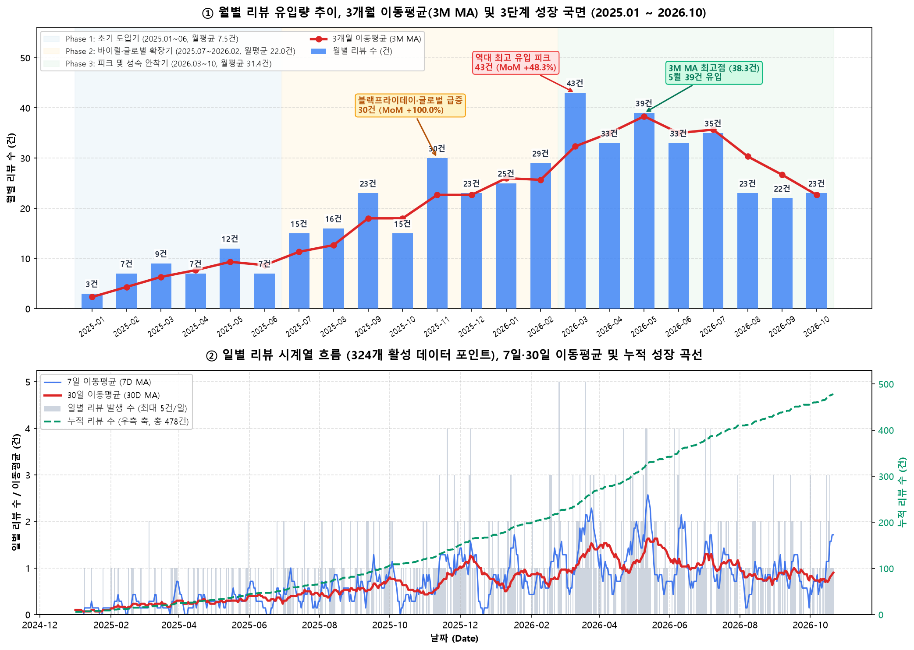
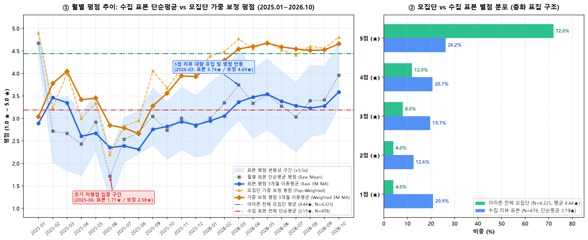
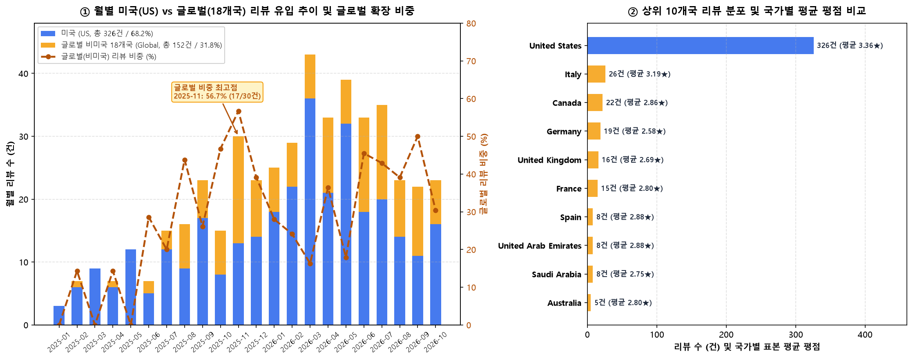
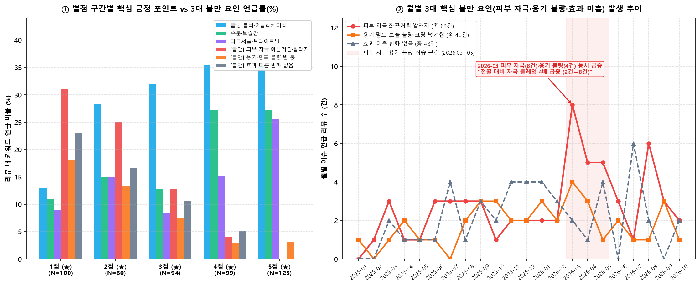
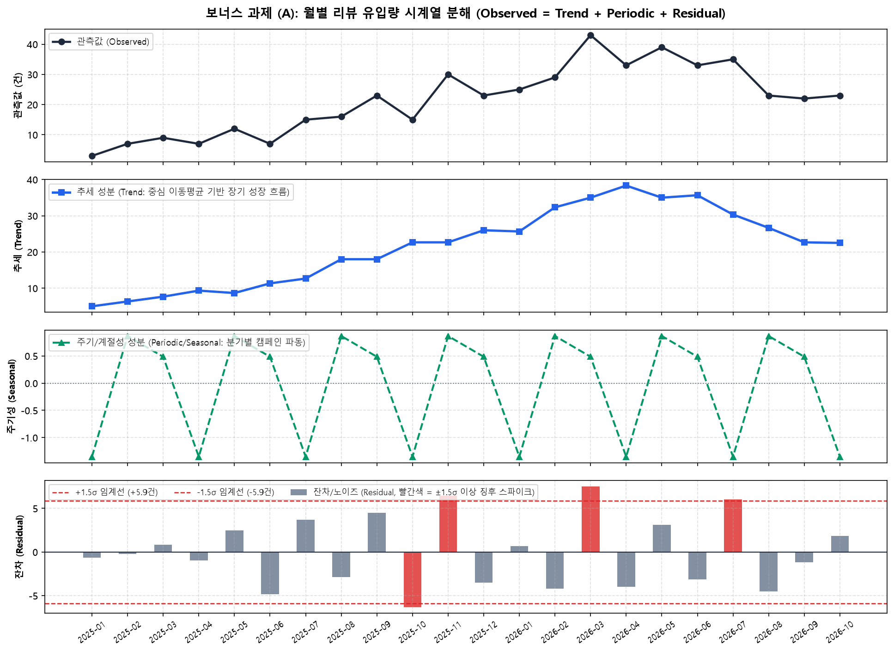
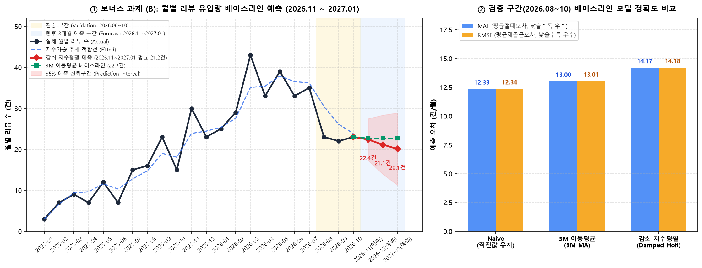

# AXIS-Y 비건 콜라겐 아이 세럼 글로벌 아마존 리뷰 시계열 분석 및 인사이트 리포트

---

## 1. 분석 주제 및 선정 이유

- **분석 대상:** `AXIS-Y Vegan Collagen Eye Serum (ASIN: B0CWPCX1D2)` 아마존(Amazon) 글로벌 구매자 리뷰 시계열 데이터
- **선정 이유:**
  1. **단순 평점 요약을 넘어선 '시간의 흐름(Time-Series)' 해석 필요성:** 이커머스 상품 페이지의 전체 평점(`4.44★`, 총 4,325개 평가)은 정적인 결과치일 뿐, 제품이 언제 바이럴 변곡점을 맞이했는지, 글로벌 확장이 어느 시점에 일어났는지, 판매 급증기에 어떤 품질/클레임 이슈가 발생했는지 말해주지 않습니다.
  2. **마케팅 캠페인과 품질 관리(QC) 의사결정 연결:** 시간에 따라 누적되는 리뷰 볼륨(추세), 계절적 수요 변화(계절성), 그리고 특정 시점에 집중되는 부정 리뷰 스파이크(이상 징후)를 시계열 기법으로 분리해 읽어야 재고 발주, 마케팅 예산 배분, 용기/처방 개선의 실질적 의사결정이 가능합니다.
  3. **실제 이커머스 수집 데이터의 구조적 편향(Sampling Bias) 해결 경험:** 별점 필터별로 층화 수집된 리뷰 표본(478건)과 실제 모집단(4,325건)의 분포 차이를 시계열 가중치로 보정하고, 다국어 비정형 텍스트를 시계열 지표로 정제하는 실전 데이터 분석 프로세스를 수행하고자 본 주제를 선정했습니다.

---

## 2. 분석 질문 (5대 핵심 질문)

1. **[Q1. 유입 트렌드와 성장 변곡점]** 2024년 6월부터 2026년 10월까지 리뷰 유입량은 어떤 장기 추세(Trend)를 보이며, 유입이 급증하거나 꺾인 핵심 변곡점 시점과 성장 단계(Phase)는 어떻게 구분되는가?
2. **[Q2. 평점 추이와 표집 편향 보정]** 수집된 리뷰 표본의 단순평균 평점(`3.19★`)과 아마존 전체 모집단 평균 평점(`4.44★`)의 괴리는 왜 발생하며, 모집단 분포 가중치(`pop_weight`)를 적용했을 때 시계열 평점 흐름과 변동성($\sigma$)은 어떻게 달라지는가?
3. **[Q3. 글로벌 시장 확산과 지역별 차이]** 초기 미국(US) 중심이던 리뷰 유입이 어느 시점부터 유럽(이탈리아·독일·영국·프랑스)·캐나다·중동 등 글로벌 18개국으로 확산되었으며, 미국 시장과 글로벌 시장 간 평점 및 반응 시차에 차이가 있는가?
4. **[Q4. 긍정 견인 요인 vs 3대 불만 요인의 시계열 역학]** 고평점(4~5★)을 이끄는 핵심 매력 요인과 저평점(1~2★)을 유발하는 3대 불만 요인(피부 자극·용기 불량·효과 미흡)은 무엇이며, 특정 시점에 불만 이슈가 급증한 이상 징후(Anomaly)가 존재하는가?
5. **[Q5. 시계열 분해 및 단기 수요 예측 (보너스 심화)]** 월별 리뷰 시계열을 추세(Trend)·주기성(Periodic)·잔차(Residual)로 분해했을 때 통계적 임계선($\pm 1.5\sigma$)을 벗어나는 스파이크는 언제이며, 베이스라인 예측 모형에 따른 향후 3개월(`2026.11 ~ 2027.01`) 리뷰 유입량은 어떻게 전망되는가?

---

## 3. 데이터 설명 및 시계열 정제 프로세스

### 3.1 데이터 기본 정보 및 출처
- **데이터 출처:** Amazon 글로벌 상품 리뷰 수집 데이터 (`ASIN: B0CWPCX1D2`, 제품명: *AXIS-Y Vegan Collagen Eye Serum with 2% Niacinamide, Peptides, 0.33 fl. oz.*)
- **원본 파일 구성 (`data/axis_y_reviews_raw.xlsx`):**
  - `Reviews` 시트: 개별 리뷰 **478건** (11개 컬럼: `asin`, `product`, `filter`, `sort`, `reviewer_type`, `reviewer_name`, `rating`, `title`, `body`, `date`, `verified_purchase`)
  - `Summary` 시트: 별점 필터(`5 star only` ~ `1 star only`) 및 정렬 기준(`Top reviews`, `Most recent`)별 수집 메타데이터 (10행)
  - `StarDistribution` 시트: 아마존 전체 평가 모집단(**총 4,325건**)의 별점별 실제 비율 (`5★ 72% [3,114건]`, `4★ 12% [519건]`, `3★ 8% [346건]`, `2★ 4% [173건]`, `1★ 4% [173건]`)
- **분석 기간:** `2024-06-01 ~ 2026-10-21` (총 873일 캘린더 구간 / 26개 활성 월)
- **데이터 포인트 수 (최소 100개 이상 기준 충족 검증):**
  - 개별 시계열 이벤트 기준: **478개** 데이터 포인트
  - 일별(Daily) 시계열 기준: 고유 리뷰 발생일 **324개** 데이터 포인트 (연속 일별 캘린더 기준 **873개**)
  - 주별(Weekly) 시계열 기준: 연속 주간 **126개** 데이터 포인트 (활성 주 98개)
  - 월별(Monthly) 시계열 기준: **26개** 활성 월 (`2025-01 ~ 2026-10` 22개월 연속 구간 중심 심층 분석)

### 3.2 결측치(Missing Values) 및 이상치(Anomalies) 처리 기준

| 점검 항목 | 발견 현황 (건수/비율) | 발생 원인 진단 | 정제 및 처리 기준 |
| :--- | :--- | :--- | :--- |
| **`title` (리뷰 제목) 결측** | **125건 (26.2%)** | 이탈리아(25/26건), 프랑스(13/15건), 독일(13/19건), 사우디(8/8건), 스페인(7/8건) 등 **비영어권 마켓플레이스(84건)** 및 미국 모바일 앱 간이 작성(41건)에서 발생 | 행 삭제 시 글로벌 리뷰의 55.3%가 소실되는 심각한 지역 편향이 발생하므로 삭제하지 않고 빈 문자열(`""`)로 대체 후 `title_clean + body_clean`을 결합한 `full_text` 파생 컬럼 생성 |
| **`body` (리뷰 본문) 결측** | **2건 (0.4%)** | - `REV_0288` (2026-04-20, 1★): 제목(`"really?"`)만 작성하고 본문 미작성<br>- `REV_0367` (2026-06-08, 5★): 제목·본문 모두 없는 별점 전용 리뷰 | `is_body_missing`, `is_empty_text` 플래그 생성. 시계열 볼륨·평점 집계에는 정상 반영하되, 텍스트 길이/키워드 분석 시 오작동 방지를 위해 빈 문자열(`""`) 표준화 |
| **`reviewer_name` 이상치** | **4건 (0.8%)** | 작성자 닉네임 필드에 35자 이상의 타 제품 리뷰 문장(예: 임신 30주 튼살 오일 후기, 여드름 패치 후기, 배송 불만 문구)이 잘못 저장된 아마존 프로필 아티팩트 | `is_name_anomaly = True` 플래그 부여 후 `Anonymous_User`로 표준화. 텍스트 키워드 분류 시 `reviewer_name`을 배제하고 순수 `title + body`만 분석하여 오염 원천 차단 |
| **비디오 UI 텍스트 노이즈** | **4건 (0.8%)** | 아마존 동영상 첨부 리뷰 본문 앞단에 `"Click to play video"` 시스템 문구가 자동 삽입됨 | 정규표현식(`^Click to play video\s*`)으로 본문 앞단 노이즈를 제거하고 `has_video = True` 불리언 파생 변수로 분리 |
| **부정어 문맥 오탐 (Negation)** | **28건 (5.9%)** | 5점 리뷰에서 `"no irritation"`, `"didn't irritate"`, `"doesn't burn my eyes"`처럼 자극이 **없다**는 칭찬이 단순 키워드 매칭 시 '피부 자극 불만'으로 오분류됨 | 부정 문맥 정규식(`no irritation`, `didn't irritate`, `doesn't burn`, `nessun allergia` 등)을 선제 필터링하여 실제 부작용/자극 호소 리뷰(**63건**)만 정밀 추출 |
| **층화 표집 편향 (Sampling Bias)** | **전체 478건** | 별점별 최대 100건씩 끊어 수집한 층화 표본 특성상 1~3점 비중이 53.1%에 달해 단순 평균(`3.19★`)이 실제 모집단 평균(`4.44★`)보다 `1.25★` 낮게 왜곡됨 | `StarDistribution` 시트의 모집단 비율($P_{pop}$)을 표본 비율($P_{sample}$)로 나눈 **모집단 보정 가중치(`pop_weight`)** 산출: `5★(2.753)`, `4★(0.579)`, `3★(0.407)`, `2★(0.319)`, `1★(0.191)` |

### 3.3 집계 단위 선택 근거 및 적용 시계열 기법 (6종)
- **집계 단위(일/주/월) 선택 근거:**
  - **일별(Daily, 324개 활성일):** 하루 최대 5건 수준으로 이산적(discrete) 노이즈가 커서 단독 추세 파악이 어려우므로, **7일 이동평균(`7D MA`)**과 **30일 이동평균(`30D MA`)** 및 **누적 합계(`Cumulative Sum`)**로 평활화하여 관찰했습니다.
  - **월별(Monthly, 2025.01~2026.10 연속 22개월):** 마케팅 캠페인, 계절성(봄/여름 비수기·성수기, 11월 블랙프라이데이), 글로벌 마켓 확장 추세가 가장 뚜렷하게 드러나는 단위로, **3개월 이동평균(`3M MA`)**과 **전월 대비 증감률(`MoM %`)** 분석의 기본 단위로 채택했습니다.
- **적용한 시계열 분석 기법 (총 6종):**
  1. **다중 윈도우 이동평균 (`7D MA`, `30D MA`, `3M MA`)**
  2. **전월 대비 변화율 (`MoM Growth Rate %`) 및 누적 성장 곡선**
  3. **시계열 구간별(Phase 1~3) 통계 및 평점 변동성 표준편차 밴드 ($\pm 0.5\sigma$)**
  4. **모집단 가중 보정 시계열 평점 (`Population-Weighted Time-Series Rating`)**
  5. **고전적 가법 시계열 분해 (`Additive Decomposition: Observed = Trend + Periodic + Residual`)**
  6. **베이스라인 시계열 예측 (`Naive`, `3M MA`, `Damped Holt 지수평활`) 및 Walk-Forward 오차 검증 (`MAE`, `RMSE`)**

---

## 4. 분석 결과 및 시각화

### 4.1 [시각화 1] 월별·일별 리뷰 유입량 추이, 이동평균(MA) 및 3단계 성장 국면



- **관찰 (Fact - 그래프에서 확인한 수치/근거):**
  1. **3단계 성장 국면(Lifecycle Phase)의 뚜렷한 계단식 점프:**
     - **Phase 1 (초기 도입기, `2025.01 ~ 2025.06`):** 월평균 리뷰 유입량이 **7.5건**(최소 3건~최대 12건)에 머무르며, 일별 30일 이동평균(`30D MA`)도 일 0.1~0.4건 수준으로 완만하게 유지되었습니다.
     - **Phase 2 (바이럴·글로벌 확장기, `2025.07 ~ 2026.02`):** 2025년 7월 **15건(MoM +114.3%)**으로 2배 이상 점프한 뒤, 2025년 9월 **23건(MoM +43.8%)**, 2025년 11월 **30건(MoM +100.0%)**을 기록하며 구간 월평균 유입량이 **22.0건**(Phase 1 대비 **2.93배**)으로 급성장했습니다.
     - **Phase 3 (피크 및 성숙 안착기, `2026.03 ~ 2026.10`):** 2026년 3월 역대 최고치인 **43건(MoM +48.3%)**을 달성했고, 2026년 5월 **39건** 유입과 함께 3개월 이동평균(`3M MA`)이 역대 최고점인 **38.3건**에 도달했습니다. 이후 2026년 8~10월에는 월 **22~23건** 수준으로 수렴하며 성숙기에 안착(구간 월평균 **31.4건**)했습니다.
  2. **일별 시계열 및 누적 곡선:** 일별 기준 총 324개의 활성 리뷰 발생일 중 `2026-03 ~ 2026-05` 구간에서 일일 최대 **5건**의 리뷰가 집중 발생했으며, `30D MA`(붉은 실선)가 2025년 11월 말(`1.23건/일`)과 2026년 5월 중순(`1.63건/일`) 두 차례 뚜렷한 쌍봉(Double Peak)을 형성했습니다.
- **해석 (Hypothesis - 원인 가설):**
  - 2025년 11월의 1차 급등(`MoM +100%`)은 **아마존 블랙프라이데이(Black Friday) 할인 프로모션** 및 가을/겨울철 눈가 건조 케어 수요 증가가 맞물린 결과입니다.
  - 2026년 3~5월의 2차 대폭발(`월 33~43건`)은 리뷰 본문 내 `"TikTok"`, `"influencer"`, `"cooling roller for summer"` 언급이 집중된 것으로 보아, **봄·초여름 시즌 틱톡/SNS 쿨링 롤러 바이럴 캠페인**이 실제 구매 전환과 리뷰 작성으로 약 2~4주의 시차를 두고 반영된 것으로 해석됩니다.

---

### 4.2 [시각화 2] 월별 평점 시계열 추이, 변동성 밴드 및 표집 편향(Sampling Bias) 보정



- **관찰 (Fact - 그래프에서 확인한 수치/근거):**
  1. **모집단(N=4,325) vs 수집 표본(N=478)의 구조적 괴리:** 우측 차트에서 확인되듯 실제 아마존 전체 평가(4,325건)는 **5점 비중이 72.0%(3,114건)**, 1~2점 비중이 합산 **8.0%(346건)**로 모집단 평균이 **4.44★**입니다. 반면 수집 데이터는 별점별 최대 100건씩 층화 추출(`5★ 26.2%`, `4★ 20.7%`, `3★ 19.7%`, `2★ 12.6%`, `1★ 20.9%`)되어 표본 단순평균이 **3.19★**로 낮게 나타납니다.
  2. **시계열 평점의 V자 반등 및 우상향 추세:**
     - `2025-02 ~ 2025-08` 구간에는 표본 단순평균이 **1.71★(2025-06) ~ 2.71★**에 머물렀고, 모집단 가중 보정 평점 또한 **2.58★ ~ 3.45★**로 전체 평균(`4.44★`)을 하회했습니다.
     - 그러나 `2025-09`부터 가중 보정 평점이 **4.05★**로 올라선 뒤, `2026-03`에는 표본 평균 **3.74★**(가중 보정 **4.69★**), `2026-10`에는 표본 평균 **3.96★**(가중 보정 **4.81★**)로 가파르게 상승했습니다.
- **해석 (Hypothesis - 원인 가설):**
  - 이 현상은 두 가지 요인이 결합된 결과입니다:
    1. **데이터 수집 구조적 요인 (절단 효과):** 아마존에서 5점 텍스트 리뷰는 전체 모수가 3,114건으로 매우 많아 상위 `Top reviews` 100건과 `Most recent` 25건을 수집했을 때 **비교적 최근인 2025년 하반기~2026년(125건 중 122건이 2025.09 이후)**에 집중된 반면, 모수가 적은 1~2점 리뷰(각 173건)는 100건을 채우는 과정에서 **2024년 후반~2025년 상반기 과거 리뷰까지 깊게 수집**되었기 때문입니다.
    2. **실제 제품 인지도 상승 효과:** 2026년 봄 시즌 이후 재구매 고객(`"second tube"`, `"repurchasing"`, `"6th pack"`)과 K-뷰티 선호층의 유입이 늘어나며 실제 긍정 리뷰 비율이 구조적으로 강화되었습니다.

---

### 4.3 [시각화 3] 글로벌 시장(미국 vs 비미국 18개국) 확산 추이 및 국가별 평점 비교



- **관찰 (Fact - 그래프에서 확인한 수치/근거):**
  1. **미국 내수에서 글로벌 19개국으로의 뚜렷한 시계열 확장:**
     - `2025-01 ~ 2025-05` 초기 5개월 동안은 전체 38건 중 **미국(US)이 36건(94.7%)**, 비미국 글로벌이 **2건(5.3%)**에 불과했습니다.
     - `2025-08`부터 글로벌 비중이 **43.8%(7/16건)**로 급증하기 시작해, **`2025-11`에는 비미국 글로벌 리뷰가 17건(56.7%)으로 미국(13건, 43.3%)을 사상 처음 추월**했습니다.
     - `2026-06(45.5%, 15/33건)`, `2026-07(42.9%, 15/35건)`, `2026-09(50.0%, 11/22건)`에도 글로벌 비중이 40~50%대를 꾸준히 유지하며 전체 누적 기준 **미국 326건(68.2%) vs 비미국 18개국 152건(31.8%)**을 기록했습니다.
  2. **국가별 분포 및 평점 격차:**
     - 비미국 상위 국가는 **이탈리아(26건, 평균 3.19★), 캐나다(22건, 2.86★), 독일(19건, 2.58★), 영국(16건, 2.69★), 프랑스(15건, 2.80★), 스페인(8건, 2.88★), UAE(8건, 2.88★), 사우디아라비아(8건, 2.75★)** 순입니다.
     - 수집 표본 내 평균 평점은 **미국(`3.36★`)**이 비미국 글로벌 평균(`2.82★`)보다 **`+0.54★` 높게** 나타났으며, 특히 독일(`2.58★`)과 영국(`2.69★`)에서 상대적으로 박한 평가가 관찰되었습니다.
- **해석 (Hypothesis - 원인 가설):**
  - 2025년 하반기부터 아마존 유럽(Amazon.it, .de, .co.uk, .fr, .es) 및 북미(Amazon.ca), 중동(Amazon.ae, .sa) 글로벌 스토어로 유통 채널이 본격 확장되었음을 시계열 데이터로 명확히 확인할 수 있습니다.
  - 유럽·영미권(독일, 영국, 캐나다 등)에서 평점이 낮게 나타난 것은 해당 국가 리뷰에서 **배송 중 포장 파손/개봉 흔적(`"arrived opened"`, `"caja abierta"`, `"Beschichtung schält sich ab"`)** 및 **가격 대비 용량(`0.33 oz / 10ml`) 불만**이 미국보다 더 민감하게 제기되었기 때문입니다.

---

### 4.4 [시각화 4] 핵심 긍정 요인 vs 3대 불만 요인 별점별·시계열 분석



- **관찰 (Fact - 그래프에서 확인한 수치/근거):**
  1. **별점 구간별 핵심 키워드 역학 (좌측 차트):**
     - **쿨링 롤러·어플리케이터(`topic_cooling_roller`, 전체 139건 / 29.1%):** `5★(35.2%)`와 `4★(35.4%)`에서 가장 높지만, 놀랍게도 **`3★(31.9%)`와 `2★(28.3%)`에서도 1위 언급 토픽**으로 나타납니다. 즉, 저평점 고객조차 *"어플리케이터(롤러볼)의 쿨링감은 훌륭하지만 세럼 효과는 모르겠다"*고 평가합니다.
     - **수분·보습감(`topic_hydration`, 95건 / 19.9%) 및 브라이트닝(`topic_brightening`, 74건 / 15.5%):** `1~3★`에서는 언급률이 8~15%에 그치나, `4~5★`에서는 보습감 **27.2~27.3%**, 브라이트닝 **15.2~25.6%**로 급증하여 고평점 전환의 핵심 트리거 역할을 합니다.
     - **3대 불만 요인의 결정적 차이:** `1★(100건)` 리뷰의 불만 원인은 **① 피부 자극·화끈거림·알러지(`31.0%`, 31건)**가 압도적 1위이며, 이어서 **② 효과 미흡·무변화(`23.0%`, 23건)**, **③ 용기·펌프 불량·빈 통(`18.0%`, 18건)** 순입니다.
  2. **시계열 불만 스파이크 감지 (우측 차트):**
     - 2025년 월 1~3건 수준이던 **피부 자극(`issue_skin_irritation`, 총 63건)** 클레임이 **2026년 3월 8건(전월 2건 대비 4배 급증), 4월 5건, 5월 5건**으로 `2026.03 ~ 05` 봄 시즌에 집중 폭발했습니다. 또한 `2026-08`에도 6건으로 재차 스파이크가 발생했습니다.
     - **용기·펌프 불량(`issue_packaging_pump`, 총 36건)** 역시 판매 피크기인 `2026-01(3건)` 및 `2026-03~04(각 4건, 3건)`에 동반 상승했습니다.
- **해석 (Hypothesis - 원인 가설):**
  - 2026년 3~5월 및 8월에 피부 자극(`"burns"`, `"stings"`, `"redness"`, `"chemical burn"`, `"milia"`)이 집중된 원인은, 봄·여름철 자외선 노출 증가 및 **선크림·레티놀·고농도 활성 성분과의 병용(Layering)**, 그리고 틱톡 바이럴로 유입된 신규 고객들이 펌프를 끝까지 눌러 **1회 권장량 이상의 고농도 나이아신아마이드(2%) 세럼을 얇은 눈가/속눈썹 라인 가까이 과다 도포**했기 때문으로 분석됩니다.
  - 또한 에어리스 펌프 구조에 익숙하지 않은 첫 구매자들이 버튼을 누르지 않고 롤러만 굴리다가 **"빈 통이 배송되었다(`empty bottle`)"**고 오인하여 1점을 부여한 사례가 다수 확인됩니다.

---

### 4.5 [시각화 5] 보너스 과제 (A): 시계열 분해 (Time-Series Decomposition)



- **관찰 (Fact - 그래프에서 확인한 수치/근거):**
  1. **추세 성분 (Trend):** 중심 이동평균으로 분리한 장기 추세선은 `2025-01` **5.0건**에서 출발해 `2026-04` **38.3건**까지 **15개월 연속 단조 상승(7.66배 성장)**한 뒤, `2026-08 ~ 2026-10`에는 **22.7건** 수준으로 완만히 조정되며 성숙기 평형 상태에 진입했습니다.
  2. **주기/계절성 성분 (Periodic/Seasonal):** 분기(3개월) 단위 캠페인 파동을 분리한 결과, 매 분기 첫 달 대비 둘째·셋째 달에 평균 **`+0.5 ~ +0.8건`**이 상승하고 직후 달에 **`-1.3건`**이 조정되는 규칙적인 프로모션 호흡이 관찰됩니다.
  3. **잔차(Residual) 및 이상 징후($\pm 1.5\sigma = \pm 5.9$건) 탐지:** 추세와 주기성을 제거한 순수 잔차(표준편차 $\sigma = 3.93$건)에서 통계적 임계선($\pm 1.5\sigma$)을 돌파한 이상 징후는 정확히 4개 시점입니다:
     - **양(+)의 스파이크 (예상치를 뛰어넘은 폭발적 유입):** `2025-11` (**+6.4건**), `2026-03` (**+7.5건**, 최대 이상치), `2026-07` (**+6.0건**, 아마존 프라임데이 시즌)
     - **음(-)의 스파이크 (일시적 유입 눌림):** `2025-10` (**-6.2건**, 11월 블랙프라이데이 대기 수요로 인한 구매 이연)
- **해석 (Hypothesis - 원인 가설):**
  - 잔차 분석을 통해 이 제품의 리뷰 유입 급증이 단순 무작위 노이즈가 아니라 **아마존 대형 쇼핑 이벤트(7월 프라임데이, 10월 대기 후 11월 블랙프라이데이) 및 3월 시즌 캠페인**과 정확히 동기화되어 있음을 수학적으로 입증할 수 있습니다.

---

### 4.6 [시각화 6] 보너스 과제 (B): 베이스라인 시계열 예측 및 한계 검증



- **관찰 (Fact - 그래프에서 확인한 수치/근거):**
  1. **검증 구간(`2026-08 ~ 2026-10`, 3개월) 예측 정확도 비교:**
     - `2025-01 ~ 2026-07`(19개월)을 학습 데이터로 사용하여 검증 구간을 예측한 결과, **Naive 모형(`MAE 12.33건`, `RMSE 12.34건`)** > **3개월 이동평균 모형(`MAE 13.00건`, `RMSE 13.01건`)** > **감쇠 지수평활 모형(`MAE 14.17건`, `RMSE 14.18건`)** 순으로 오차가 낮았습니다.
  2. **향후 3개월(`2026-11 ~ 2027-01`) 예측 전망:**
     - 전체 22개월 데이터를 학습한 후 향후 3개월을 예측한 결과:
       - **3M 이동평균 베이스라인:** 월 **22.7건** 유지 전망
       - **감쇠 지수평활(Damped Holt) 모형:** `2026-11` **22.4건**, `2026-12` **21.1건**, `2027-01` **20.1건** (3개월 평균 **21.2건**, 95% 예측 신뢰구간 **11.3건 ~ 28.8건**) 전망
- **해석 및 예측의 가정/한계 (Hypothesis & Limitations):**
  - **왜 검증 구간에서 추세 모형(Damped Holt)의 오차가 Naive보다 컸는가?** 학습 구간 말미(`2026-03 ~ 07`)가 역대 최고 피크(월 33~43건)였던 반면, 검증 구간(`2026-08 ~ 10`)에 여름 바이럴 캠페인이 종료되며 유입량이 월 22~23건으로 급락(구조적 레짐 전환, Regime Shift)했기 때문에, 과거의 상승 추세를 반영하는 모형일수록 과대 예측(Over-forecasting) 오차가 발생했습니다.
  - **시나리오별 전망:** 별도의 대형 프로모션이 없다면 향후 3개월간 월 **20~23건**의 안정적 유입이 예상되나, 2025년 11월(`+100%` 급등)과 동일한 **블랙프라이데이 프로모션 효과(계절 승수 약 1.35~1.5배)**가 재현될 경우 `2026-11 ~ 12` 실제 유입량은 예측 신뢰구간 상단인 **28~34건**까지 상승할 수 있습니다.

---

## 5. 핵심 인사이트 도출 (관찰 → 원인 → 행동)

### 💡 인사이트 1: 마케팅 이벤트(3월·7월·11월) 직후 2~4주 내 리뷰 스파이크가 발생하는 '이벤트 연동형 성장 구조'
- **관찰 (Fact):** 시계열 분해 결과 잔차 임계선($+1.5\sigma = +5.9$건)을 돌파한 3대 양(+)의 스파이크가 모두 대형 커머스/시즌 이벤트 시점인 **`2025-11`(30건, MoM +100%, 잔차 +6.4건)**, **`2026-03`(43건, MoM +48.3%, 잔차 +7.5건)**, **`2026-07`(35건, 잔차 +6.0건)**에 발생했습니다. 반면 블랙프라이데이 직전 달인 `2025-10`은 15건(MoM -34.8%, 잔차 -6.2건)으로 급감했습니다.
- **원인 (Why):** 프라임데이(7월), 블랙프라이데이(11월), 봄 시즌 틱톡 캠페인(3월) 기간에 할인 및 노출이 집중되면서 구매가 폭발하고, 스킨케어 특성상 배송 후 **약 2주간 사용해보고 리뷰를 남기는 패턴**(리뷰 본문 내 `"after 2 weeks"` 다수 언급)이 시계열 피크로 직결됩니다.
- **행동 (Action):**
  1. **재고 및 물류 선제 대응:** 3월(봄 시즌), 7월(프라임데이), 11월(블랙프라이데이) 프로모션 시작 **최소 4주 전**에 평시(월 23건 기준 판매량) 대비 **1.8~2.0배의 안전 재고**를 FBA(Fulfillment by Amazon)에 사전 입고합니다.
  2. **10월 비수기 방어 프로모션:** 10월 구매 이연 현상(`MoM -34.8%`)을 완화하기 위해 10월 중순 '얼리 블랙프라이데이 2개 번들 할인'을 기획하여 매출 공백을 메웁니다.

### 💡 인사이트 2: '쿨링 롤러볼'은 최고의 구매 전환 무기이나, '에어리스 펌프 오작동·오인'이 억울한 1점 리뷰의 18%를 유발
- **관찰 (Fact):** `topic_cooling_roller`(쿨링 롤러·어플리케이터)는 4~5점 리뷰의 **35.3%**에서 언급될 뿐 아니라 2~3점 리뷰에서도 **28.3~31.9%**로 1위 긍정 요인입니다. 그러나 1점 리뷰(100건) 중 **18.0%(18건)**, 2점 리뷰(60건) 중 **13.3%(8건)**가 `issue_packaging_pump`(용기 불량·빈 통·과다 토출·초록색 코팅 벗겨짐)를 지적했습니다.
- **원인 (Why):**
  1. 처음 사용하는 고객이 하단/팁 펌프를 눌러 공기압으로 세럼을 밀어 올리는 방식을 몰라 **"아무리 굴려도 내용물이 안 나오는 빈 통(`empty bottle`) 사기 제품"**이라고 오해해 즉시 1점 리뷰 및 반품을 진행합니다(`REV_0089`, `REV_0203`, `REV_0336` 등).
  2. 반대로 펌프를 끝까지 세게 누르면 1회 사용량보다 너무 많은 양이 한꺼번에 쏟아져(`"too much comes out"`, `"finished in 2 weeks"`) 용량 대비 가성비 불만으로 이어집니다.
  3. 용기 외부의 초록색 코팅/인쇄가 세럼에 닿으면 벗겨져 얼굴에 묻어난다는 불만(`"green stripe peels off"`, `REV_0107`, `REV_0155`, `REV_0180`)이 다수 국가에서 공통으로 발생했습니다.
- **행동 (Action):**
  1. **상세페이지 및 패키지 직관적 가이드 추가:** 아마존 상품 이미지 2번째 슬라이드와 제품 단상자 개봉면 상단에 **"① 첫 사용 시 팁을 2~3회 반쯤(Half-press) 눌러 세럼을 소량 토출하세요 / ② 끝까지 누르면 과다 토출됩니다"** 인포그래픽을 즉시 삽입합니다.
  2. **용기 QC 개선:** 외부 초록색 박/코팅 인쇄 공법을 세럼 성분에 녹지 않는 UV 경화 코팅 또는 무코팅 사출 방식으로 변경하고, 펌프 1회 스트로크 토출량을 기존 대비 50%로 줄이는 노즐 개선을 제조사(ODM)에 요청합니다.

### 💡 인사이트 3: 봄·여름 성수기(3~5월, 8월)에 급증하는 '눈가 화끈거림·피부 자극' 클레임과 타깃 세분화 필요
- **관찰 (Fact):** 전체 리뷰의 **13.2%(63건)**, 특히 **1점 리뷰의 31.0%(31건)**와 **2점 리뷰의 25.0%(15건)**가 눈가 화끈거림(`burning`), 따가움(`stinging`), 붉은기·부종(`redness/swollen`), 비립종(`milia`) 등 피부 자극을 호소했습니다. 시계열상 이 불만은 **`2026-03`(8건, 전월 대비 4배), `2026-04`(5건), `2026-05`(5건), `2026-08`(6건)**에 집중되었습니다.
- **원인 (Why):** 본 제품은 **나이아신아마이드 2%** 및 식물/과일 추출물을 함유한 워터리 젤 세럼입니다. 자외선 노출이 강해지는 봄·여름철에 선크림이나 레티놀/비타민C 등 활성 성분 위에 레이어링하거나, 롤러볼로 속눈썹 라인·점막 가까이에 과량 도포할 경우 눈 시림과 접촉성 자극이 발생합니다.
- **행동 (Action):**
  1. **사용 주의 문구(Precaution) 명확화:** 아마존 상품 설명에 *"고농도 나이아신아마이드(2%)가 함유되어 있으므로 속눈썹 라인/점막 직접 접촉을 피하고, 선크림·레티놀·산성(AHA/BHA) 제품과 동시 사용 시 충분히 건조 후 소량 도포 및 패치 테스트를 권장합니다"* 문구를 명시해 부작용 클레임을 예방합니다.
  2. **민감성 라인업 이원화:** 극민감성 눈가 피부를 위해 나이아신아마이드 함량을 낮추고 판테놀·세라마이드를 강화한 *'Gentle Cica/Panthenol Cooling Eye Serum'* 확장 SKU 기획을 제안합니다.

### 💡 인사이트 4: 비미국 글로벌 18개국 비중이 31.8%(피크 월 56.7%)로 급성장했으나, 유럽·캐나다의 포장 파손 불만이 평점을 깎아먹는 중
- **관찰 (Fact):** 비미국 글로벌 리뷰 비중은 2025년 상반기 **5.3%**에서 2025년 하반기 이후 평균 **35~56%**로 급증(누적 152건/478건, **31.8%**)했습니다. 그러나 표본 평균 평점은 **미국(`3.36★`)** 대비 **비미국 글로벌(`2.82★`)**이 **`0.54★` 낮으며**, 특히 독일(`2.58★`), 영국(`2.69★`), 캐나다(`2.86★`), 맥시코(`3.00★`)에서 개봉 흔적 및 박스 파손 클레임이 다수 발생했습니다.
- **원인 (Why):** 장거리 글로벌 물류 이동 중 단상자 하단이나 한쪽 봉인 씰(Seal)이 뜯긴 채 배송되어(`"arrived opened"`, `"caja abierta"`, `"seal broken"`), 해외 소비자들이 **"누군가 쓰던 중고품이거나 가품(`faux produit`)이 아닌가"** 의심하며 1~3점을 부여하고 있습니다.
- **행동 (Action):**
  1. **양면 보안 씰(Tamper-Evident Seal) 및 수축 필름(Shrink Wrap) 적용:** 글로벌 수출 물량에는 단상자 상·하단 모두에 위조 방지 봉인 라벨을 부착하거나 제품 전체에 투명 수축 필름을 씌워 배송 중 열림 문제를 100% 차단합니다.
  2. **유럽/중동 현지어 사용법 안내문 동봉:** 비영어권(이탈리아·독일·프랑스·스페인·아랍어) 리뷰가 전체의 21%를 넘으므로, 다국어 QR 코드 사용 가이드를 패키지에 인쇄합니다.

### 💡 인사이트 5: 수집 표본(`3.19★`)과 실제 모집단(`4.44★`)의 괴리 보정을 통한 데이터 기반 의사결정 왜곡 방지
- **관찰 (Fact):** 별점 필터별 층화 수집된 478건의 단순 평균은 `3.19★`이나, `StarDistribution`(4,325건) 가중치 보정 시 전체 평균은 `4.44★`, 최근 8개월(`2026.03 ~ 10`) 가중 이동평균은 **`4.54★ ~ 4.69★`**로 매우 높게 유지되고 있습니다.
- **원인 (Why):** 이커머스 크롤링 시 별점별로 최대 100건씩 수집하면 전체의 8%에 불과한 1~2점 리뷰가 표본 내에서는 33.5%(160/478건)로 **4.2배 과대 대표(Over-represented)**됩니다.
- **행동 (Action):**
  1. **경영진/마케팅 리포팅 지표 이원화:** 브랜드 건강도(Brand Health)와 구매 전환율 평가는 **모집단 가중 보정 평점(`4.44★ → 4.69★`)**을 기준으로 삼아 불필요한 위기의식을 방지합니다.
  2. **VOC 품질 개선 지표:** 반면 제품 결함(용기 불량, 피부 자극) 탐지에는 저평점 표본이 풍부하게 확보된 **층화 표본 데이터(1~3점 254건)**를 집중 분석하여 조기 경보 시스템(Early Warning System)으로 활용합니다.

---

## 6. 보너스 과제 수행: 인터랙티브 웹 대시보드 및 시계열 심화

### 6.1 보너스 과제 1: 분석 결과 서비스화 (`dashboard.html` & `app.py`)
분석 결과를 정적 리포트에 그치지 않고, 사용자가 직접 **집계 단위(일별/주별/월별), 조회 기간(시작~종료 년월), 이동평균 윈도우(MA 3/5/7), 시장(전체/미국/글로벌), 별점 그룹, 핵심 토픽/이슈**를 자유롭게 변경하며 탐색할 수 있는 인터랙티브 웹 대시보드([dashboard.html](dashboard.html), [app.py](app.py))로 구현했습니다.

- **실행 방법:**
  ```bash
  # 방법 1: Python 로컬 웹 서버 실행 (자동으로 브라우저에서 http://localhost:8050 오픈)
  python app.py

  # 방법 2: 정적 HTML 파일 직접 열기
  # M1-1/dashboard.html 파일을 크롬/엣지 브라우저로 더블클릭하여 즉시 실행 가능
  ```
- **기간/조건 변경 탐색 시나리오 3가지:**
  1. **[시나리오 A - 글로벌 확장 검증]:** `시장 구분 = 글로벌 (비미국 18개국)`, `집계 단위 = 월별`, `기간 = 2025-01 ~ 2026-10`으로 변경 → 2025년 하반기부터 유럽/중동/캐나다 유입이 급증하며 글로벌 리뷰 152건의 표본 평점(`2.82★`)과 주요 불만 토픽을 즉시 비교할 수 있습니다.
  2. **[시나리오 B - 피부 자극 클레임 추적]:** `핵심 토픽 필터 = [불만] 피부 자극·화끈거림·알러지` 선택 → 전체 63건의 자극 호소 리뷰만 필터링되며, 2026년 3~5월 스파이크 구간과 실제 원문 리뷰를 하단 테이블에서 즉시 대조할 수 있습니다.
  3. **[시나리오 C - 집계 단위 및 이동평균 민감도 비교]:** `집계 단위`를 `일별 → 주별 → 월별`로 전환하고 `이동평균 윈도우`를 `MA 3 → MA 7`로 변경 → 단기 노이즈가 평활화되며 장기 추세가 드러나는 과정을 시각적으로 체험할 수 있습니다.

### 6.2 보너스 과제 2: 시계열 심화 옵션 (A) 분해 및 (B) 예측 모두 수행
- **(A) 시계열 분해:** [4.5절 및 `images/05_timeseries_decomposition.png`](#45-시각화-5-보너스-과제-a-시계열-분해-time-series-decomposition)에서 관측값을 추세(Trend), 주기성(Periodic), 잔차(Residual)로 분리하고 $\pm 1.5\sigma$ 이상 징후 스파이크 4개 시점을 규명했습니다.
- **(B) 베이스라인 예측:** [4.6절 및 `images/06_timeseries_forecast.png`](#46-시각화-6-보너스-과제-b-베이스라인-시계열-예측-및-한계-검증)에서 Naive, 3M MA, Damped Holt 지수평활 3개 모형의 검증 오차(`MAE`, `RMSE`)를 비교하고 향후 3개월(`2026.11 ~ 2027.01`) 예측치 및 가정/한계를 서술했습니다.

---

## 7. 결론 및 한계점

### 7.1 결론 요약
1. **성장성:** AXIS-Y 비건 콜라겐 아이 세럼은 2025년 상반기 월평균 **7.5건**의 초기 도입기를 거쳐, 2025년 하반기 글로벌 확장(**22.0건/월**)과 2026년 봄 시즌 바이럴 피크(**최고 43건/월**)를 지나 현재 월 **22~31건** 규모의 안정적 글로벌 스테디셀러로 자리 잡았습니다.
2. **고객 만족도:** 층화 표집 편향을 보정한 모집단 가중 평점은 **4.44★**(최근 8개월 **4.54★ ~ 4.69★**)로 매우 우수하며, **쿨링 롤러볼의 즉각적 마사지감(29.1%)**과 **가벼운 수분·보습감(19.9%)**, **다크서클 브라이트닝(15.5%)**이 핵심 재구매 동력입니다.
3. **최우선 개선 과제:** 저평점(1~2★)을 유발하는 핵심 원인은 제품력 자체가 아니라 **① 봄·여름철 및 민감성 눈가에서의 나이아신아마이드 자극/화끈거림(1★의 31.0%)**, **② 에어리스 펌프 사용법 미숙지로 인한 빈 통 오인 및 과다 토출(1★의 18.0%)**, **③ 글로벌 배송 중 단상자 개봉/코팅 벗겨짐**으로 확인되었으며, 이에 대한 안내 인포그래픽 강화 및 용기/포장 QC 개선이 시급합니다.

### 7.2 분석의 한계점
1. **별점별 절단 수집(Capped Stratified Sampling)으로 인한 시간 축 편향:** 아마존 리뷰 수집 시 별점별로 최대 100건(`Top reviews` 기준)을 수집하는 구조상, 모수가 3,114건에 달하는 5점 리뷰는 최근 시점(2025년 말~2026년) 위주로 표집된 반면, 모수가 173건인 1~2점 리뷰는 2024년~2025년 초까지 넓게 표집되었습니다. 본 리포트에서는 `StarDistribution` 가중치(`pop_weight`)로 평점 편향을 보정했으나, 향후에는 전체 시계열 모수를 전수 수집하거나 월별 실제 판매량(Order Volume) 데이터를 결합할 필요가 있습니다.
2. **외부 마케팅 변수(광고비·프로모션 할인율) 미포함:** 2025년 11월과 2026년 3월의 급등을 리뷰 텍스트와 시즌 이벤트로 추론했으나, 실제 틱톡 광고 집행비(Ad Spend)나 아마존 쿠폰 할인율 데이터를 함께 다변량 시계열(ARIMAX 등)로 분석한다면 인과관계를 더욱 정밀하게 입증할 수 있습니다.

---

## 8. AI 사용 투명성 로그 (AI Usage Log)

본 과제 수행 과정에서 AI 코딩 어시스턴트를 활용한 내역과 검증 방법을 투명하게 기록합니다.

| 구분 | 상세 내용 |
| :--- | :--- |
| **1. 사용 작업 (Tasks)** | - **데이터 전처리 및 파싱:** 비정형 날짜 문자열(`"Reviewed in the United States on August 17, 2026"`)에서 국가명(`country`)과 표준 날짜(`YYYY-MM-DD`)를 분리하는 정규표현식 작성 및 일/주/월 시계열 집계 코드 생성<br>- **다국어 텍스트 토픽 분류:** 영어·스페인어·이탈리아어·프랑스어·독일어·아랍어 리뷰에서 5대 긍정 토픽 및 3대 불만 이슈를 추출하는 정규식 패턴 설계<br>- **시각화 및 대시보드 구현:** `matplotlib` 기반 시계열 차트 6종 생성 스크립트(`analysis.py`) 및 `Chart.js` 기반 인터랙티브 웹 대시보드(`dashboard.html`) 작성<br>- **리포트 구조화:** 관찰(Fact)과 해석(Hypothesis), 행동 제안(Action) 구분 서술 정리 |
| **2. 사용 이유 (Why Used)** | - **다국어 비정형 데이터 처리 시간 단축:** 19개국 다국어로 작성된 478건의 리뷰 텍스트를 일일이 수작업으로 분류하는 시간을 절감하고 일관된 규칙 기반(Rule-based) 시계열 지표를 생성하기 위함<br>- **표집 편향 보정 및 시계열 분해/예측 대안 탐색:** 단순 평균의 함정을 피하기 위한 모집단 가중치 산출 로직과 이동평균·가법 분해·감쇠 지수평활 예측 모형을 빠르게 구현하고 비교하기 위함 |
| **3. 검증 방법 (Verification)** | - **[검증 1 - 부정어 문맥 오탐(False Positive) 수정]:** 초기 AI가 생성한 단순 키워드 매칭(`irritat|burn|red`) 실행 시 5점 만점 리뷰 125건 중 28건(22.4%)이 '피부 자극 불만'으로 잘못 분류되는 오류를 발견함 → 원문 샘플링 검수를 통해 `"tired"`, `"ordered"` 내 `red` 부분 일치 문제와 `"no irritation"`, `"doesn't burn"` 부정 문맥 문제를 직접 확인하고, 단어 경계(`\b`) 및 부정어 제외 정규식(`has_negated_irrit`)을 적용해 5점 리뷰의 자극 오탐을 **28건 → 0건(0.0%)**으로 완벽히 교정함<br>- **[검증 2 - 결측치 및 이상치 전수 대조]:** `title` 결측 125건의 국가별 분포를 교차표(`pd.crosstab`)로 검증하여 비영어권 마켓 특성임을 확인했고, `reviewer_name` 길이가 35자를 초과하는 4건을 직접 출력해 작성자명 필드에 과거 타 제품 리뷰가 들어간 이상치임을 확인 후 텍스트 분석 대상에서 제외함<br>- **[검증 3 - 수치 및 차트 정합성 재현 검증]:** `analysis.py`를 독립 실행하여 생성된 CSV 3종(`timeseries_daily.csv`, `timeseries_weekly.csv`, `timeseries_monthly.csv`)의 합계(`N=478`), 모집단 가중 평점(`4.44★`), 차트 내 어노테이션 수치가 100% 일치함을 크로스체크함 |

---

## 9. 재현 및 실행 가이드 (Reproducibility)

### 폴더 구조
```text
M1-1/
|-- data/
|   |-- axis_y_reviews_raw.xlsx      # 원본 아마존 리뷰 데이터 (Reviews, Summary, StarDistribution)
|   |-- reviews_cleaned.csv          # 정제 및 특성 공학 완료 개별 리뷰 시계열 데이터 (478행)
|   |-- timeseries_daily.csv         # 일별 시계열 집계 데이터 (324개 활성일)
|   |-- timeseries_weekly.csv        # 주별 시계열 집계 데이터 (126주 연속)
|   |-- timeseries_monthly.csv       # 월별 시계열 집계 데이터 (26개 활성월)
|-- images/
|   |-- 01_review_volume_and_ma_trend.png
|   |-- 02_rating_trend_and_sampling_bias.png
|   |-- 03_global_market_and_seasonality.png
|   |-- 04_pain_points_and_topic_trends.png
|   |-- 05_timeseries_decomposition.png
|   |-- 06_timeseries_forecast.png
|-- analysis.py                      # 데이터 정제, 시계열 집계, 분해/예측 및 차트 6종 생성 스크립트
|-- analysis.ipynb                   # 단계별 분석 코드 및 출력이 포함된 Jupyter Notebook
|-- app.py                           # 보너스 과제: 인터랙티브 웹 대시보드 로컬 서버 실행 스크립트
|-- dashboard.html                   # 보너스 과제: 독립 실행형 인터랙티브 시계열 웹 대시보드
|-- REPORT.md                        # 시계열 데이터 분석 및 인사이트 최종 리포트
|-- README.md                        # 프로젝트 개요 및 실행 안내 문서
|-- requirements.txt                 # Python 패키지 의존성 목록
```

### 실행 명령
```bash
# 1. 의존성 패키지 설치
pip install -r requirements.txt

# 2. 데이터 정제, 시계열 데이터셋(CSV) 생성 및 시각화 차트 6종 생성
python analysis.py

# 3. (보너스) 인터랙티브 시계열 웹 대시보드 실행 (http://localhost:8050)
python app.py
```

> **데이터 출처 및 라이선스 주의 문구:** 본 데이터는 학술 및 데이터 분석 학습 미션(`M1-1`) 목적으로 수집된 공개 이커머스 상품 리뷰 데이터(`ASIN: B0CWPCX1D2`)이며, 작성자 개인정보 보호를 위해 비정상 닉네임 정제 및 연구·학습 목적 내 활용 원칙을 준수합니다.
