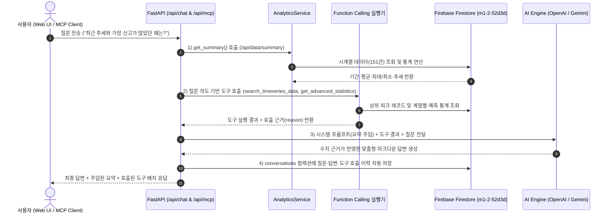
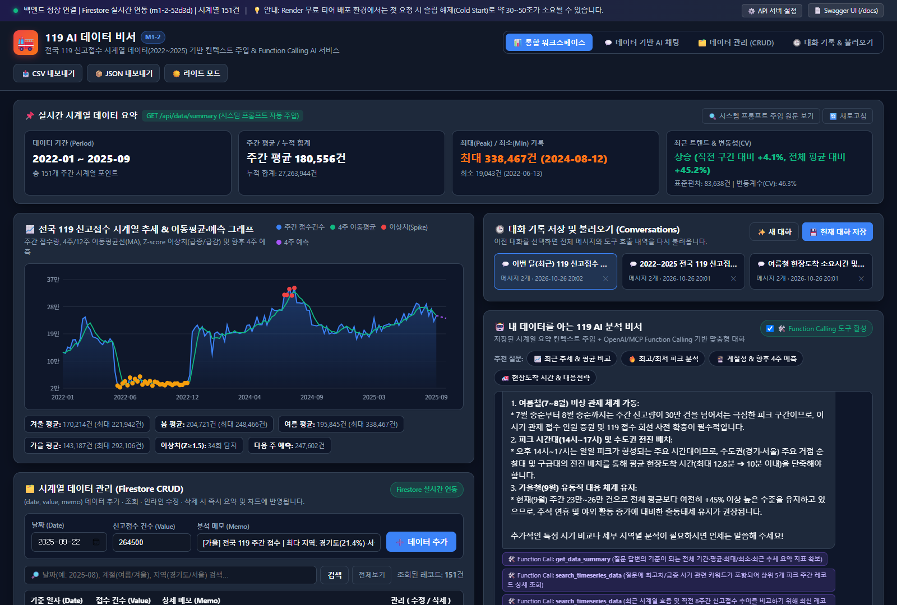
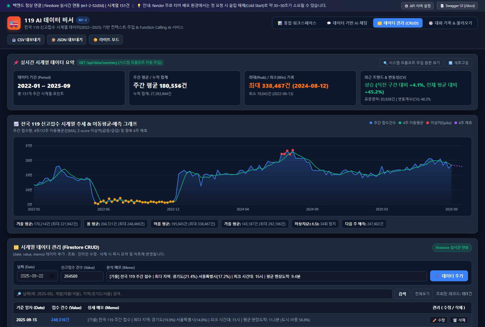
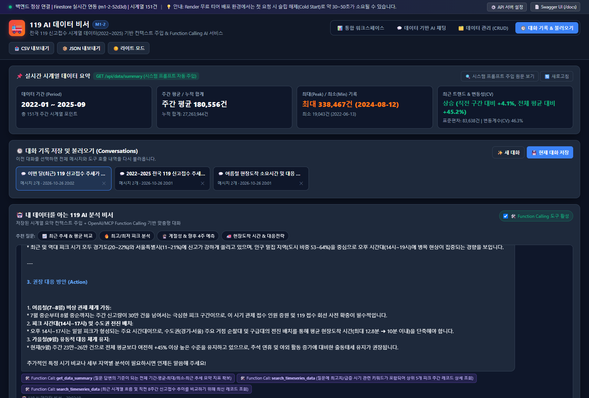
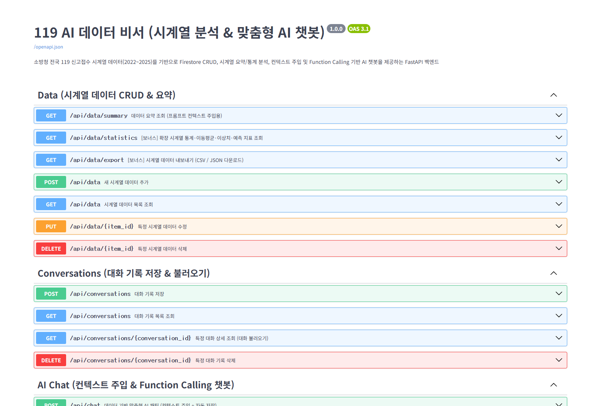

# 🚒 119 AI 데이터 비서 — 시계열 데이터 기반 맞춤형 AI 챗봇 & CRUD 웹 서비스 (M1-2)

> **"내 데이터를 이해하고 수치 근거로 답하는 AI 비서"**
> 소방청 전국 119 신고접수 현황 시계열 데이터(2022~2025, 원본 약 7.8GB / 주간 시계열 151개 포인트)를 분석·요약하여 **Firebase Firestore**에 적재하고, **시스템 프롬프트 컨텍스트 주입(Context Injection)** 및 **Function Calling(도구 호출) / MCP**를 통해 데이터에 기반한 정밀 답변을 제공하는 풀스택 웹 서비스입니다.

---

## 1. 서비스 소개 (무엇을 해결하는지)

- **배경 및 문제 정의**: 일반적인 범용 LLM(ChatGPT 등)은 기관·기업 내부의 실시간 시계열 데이터를 알지 못하기 때문에 *"최근 119 신고 추세가 어때?"*, *"가장 출동이 몰렸던 시기와 현장도착 지연 시간은?"*과 같은 질문에 일반론적인 답변만 제공합니다.
- **해결 방식**:
  1. **대용량 시계열 정제 및 요약 자동화**: 2022~2025년 전국 119 신고접수 데이터를 주간(Weekly) 시계열 **151개 데이터 포인트(`date`, `value`, `memo`)**로 집계하여 Firestore `data` 컬렉션에 관리합니다.
  2. **실시간 컨텍스트 주입(Context Injection)**: 데이터가 추가·수정·삭제될 때마다 `/api/data/summary`가 기간, 총 레코드 수, 합계/평균/최대/최소, 표준편차/변동계수(CV), 최근 추세를 즉시 재계산하여 AI 시스템 프롬프트에 주입합니다.
  3. **AI 도구 호출(Function Calling) & 멀티채널(MCP) 연동**: 질문 의도에 따라 AI가 스스로 `get_data_summary`, `search_timeseries_data`, `get_advanced_statistics`, `get_recent_conversations` 도구를 호출하여 정확한 날짜와 수치를 근거로 답변합니다.
  4. **대화 영속성 관리**: 모든 대화와 호출된 도구 근거를 Firestore `conversations` 컬렉션에 자동 저장하고 언제든 다시 불러와 이어서 대화할 수 있습니다.

---

## 2. 기술 스택 (Tech Stack)

| 구분 | 기술 및 라이브러리 | 역할 |
| :--- | :--- | :--- |
| **Backend** | Python 3.11+, **FastAPI**, **Uvicorn**, **Pydantic v2** | RESTful API 서버, 요청/응답 스키마 검증, Swagger UI(`/docs`) 제공 |
| **Database** | **Firebase Firestore** (`firebase-admin`) | `data`(시계열 데이터) 및 `conversations`(대화 이력) NoSQL 컬렉션 영속 저장 |
| **AI / LLM** | **OpenAI API** (`gpt-4o-mini`) + **Gemini 3.6 Flash** 폴백 | 시스템 프롬프트 컨텍스트 주입, Function Calling 도구 실행, 맞춤형 인사이트 생성 |
| **Multi-Channel** | **MCP Server** (`mcp_server.py`, JSON-RPC 2.0) | 외부 MCP 클라이언트 및 GPT Actions 멀티채널 도구 호출 연동 |
| **Frontend** | **Vanilla HTML5 / CSS3 / JavaScript (ES6+)** | 프레임워크 없이 구현한 반응형 대시보드, HTML5 Canvas 시계열 차트, 다크 모드 |
| **Deployment** | **Render** (Backend) / **Vercel** (Frontend) | 클라우드 배포 및 환경변수 분리 운영 (`render.yaml`, `vercel.json` 포함) |

---

## 3. 배포 URL 및 접속 안내

| 구분 | URL / 경로 | 비고 |
| :--- | :--- | :--- |
| **프론트엔드 (Vercel)** | [https://ai-frontend-eta-steel.vercel.app/](https://ai-frontend-eta-steel.vercel.app/) | 바닐라 HTML/CSS/JS 대시보드 & AI 챗봇 |
| **백엔드 API (Render)** | [https://ai-e6ub.onrender.com](https://ai-e6ub.onrender.com) | [헬스체크 (`/api/health`)](https://ai-e6ub.onrender.com/api/health) / [요약 (`/api/data/summary`)](https://ai-e6ub.onrender.com/api/data/summary) |
| **Swagger UI 문서 (Render)** | [https://ai-e6ub.onrender.com/docs](https://ai-e6ub.onrender.com/docs) | 전체 12개 엔드포인트 명세 확인 및 즉시 테스트 가능 |

> **💡 Render 무료 티어 슬립(Cold Start) 안내**
> Render 무료 플랜은 15분간 요청이 없으면 슬립 모드로 전환되어 첫 요청 시 약 30~50초의 깨우기(Wake-up) 지연이 발생할 수 있습니다. 프론트엔드 상단 배너 및 `/api/health` 헬스체크 인디케이터를 통해 연결 상태를 실시간으로 안내합니다.

---

## 4. 프로젝트 폴더 구조 및 아키텍처 설계 기준

```text
M1-2/
├── main.py                        # FastAPI 앱 초기화, CORS 설정, 라우터 등록, 정적 파일 서빙
├── config.py                      # python-dotenv 기반 환경 변수 로드 및 설정 클래스
├── schemas.py                     # Pydantic v2 요청/응답 데이터 검증 모델
├── routers/
│   ├── data_router.py             # /api/data (CRUD 4개 + /summary + /statistics + /export)
│   ├── conversations_router.py    # /api/conversations (저장, 목록, 상세 불러오기, 삭제)
│   └── chat_router.py             # /api/chat (컨텍스트 주입 + Function Calling + 자동 저장)
├── services/
│   ├── firebase_service.py        # Firestore 연동 (data, conversations 컬렉션 + 초기 151건 자동 시딩)
│   ├── analytics_service.py       # 시계열 요약, 이동평균(MA4/MA12), Z-score 이상치, 4주 예측 계산
│   └── ai_service.py              # 시스템 프롬프트 조립, Function Calling 실행기, LLM 호출
├── mcp_server.py                  # [보너스 1] MCP (Model Context Protocol) 서버 (stdio & HTTP /api/mcp)
├── scripts/
│   ├── preprocess_119_data.py     # 2022~2025 전국 119 신고접수 대용량 CSV 시계열 집계 스크립트
│   └── verify_all_apis.py         # 전체 API·Firestore·AI·MCP 엔드투엔드 자동 검증 스크립트
├── data/
│   ├── 119_timeseries.csv         # 정제된 151개 주간 시계열 데이터셋 (2022-01 ~ 2025-09)
│   └── dataset_metadata.json      # 연도별·계절별·시도별·피크 시간대 메타 통계
├── frontend/                      # 바닐라 HTML/CSS/JS 프론트엔드 (프레임워크 미사용)
│   ├── index.html
│   ├── style.css
│   ├── app.js
│   ├── config.js
│   └── vercel.json
├── screenshots/                   # 기능 동작 검증 스크린샷
├── render.yaml                    # Render 백엔드 배포 명세
├── requirements.txt               # Python 패키지 의존성 목록
└── .env.example                   # 환경변수 템플릿 (실제 키는 .env로 분리 및 .gitignore 처리)
```

### 아키텍처 및 핵심 기술 적용 기준 (학습 목표 정리)
1. **라우터(`routers/`)와 서비스(`services/`) 분리 기준**:
   - **라우터 계층**은 HTTP 경로 매핑, 쿼리 파라미터 수신, 상태 코드(`201 Created`, `404 Not Found`) 반환에만 집중합니다.
   - **서비스 계층**은 비즈니스 로직(Firestore 트랜잭션, 시계열 통계 연산, 프롬프트 조립 및 LLM 호출)을 담당하여, REST API와 MCP 서버(`mcp_server.py`)가 동일한 서비스 함수를 재사용할 수 있도록 결합도를 낮추었습니다.
2. **Pydantic 데이터 검증(`schemas.py`) 적용 이유와 방식**:
   - 잘못된 날짜 형식(`2025/13/45`)이나 음수 신고 건수(`-100`)가 DB에 저장되면 시계열 평균·추세 왜곡이 발생합니다. `DataCreate`, `DataUpdate` 모델에서 `@field_validator("date")`와 `Field(ge=0)`를 적용해 진입 시점에 `422 Unprocessable Entity`로 차단합니다.
3. **시스템 프롬프트 컨텍스트 주입(Context Injection)의 원리**:
   - 사용자의 질문이 들어올 때마다 실시간으로 `/api/data/summary` 결과를 조회하여 시스템 프롬프트의 `[사용자 데이터 요약]` 블록에 동적으로 삽입합니다. 이를 통해 모델을 재학습(Fine-tuning)하지 않고도 방금 CRUD로 추가·수정한 최신 데이터를 AI가 즉시 인지하고 답변할 수 있습니다.
4. **CORS / 환경 변수 / 보안 키 관리**:
   - 프론트엔드(Vercel)와 백엔드(Render)의 도메인(Origin)이 다를 때 브라우저의 동일 출처 정책(SOP) 차단을 해소하기 위해 `CORSMiddleware`와 `ALLOWED_ORIGINS` 환경 변수를 구성했습니다.
   - Firebase 비공개 키와 OpenAI API 키는 유출 시 과금 및 DB 침해 위험이 있으므로 `.gitignore`로 버전 관리에서 제외하고 환경 변수로만 주입합니다.

---

## 5. 보너스 과제 1: AI 도구 호출(Function Calling) & MCP 멀티채널 흐름

### 5-1. 도구 선택 근거 (어떤 근거로 어떤 도구를 호출했는가)

| 도구 이름 (`function.name`) | 호출 판단 근거 (Trigger Condition & Reason) | 반환 데이터 및 역할 |
| :--- | :--- | :--- |
| **`get_data_summary`** | 모든 데이터 기반 질문의 기준선 확보를 위해 기본 호출 | 전체 기간(`2022-01 ~ 2025-09`), 총 개수(151개), 평균/최대/최소, 최근 추세 |
| **`search_timeseries_data`** | 질문에 *"최고/최대/피크"*, *"최저/최소"*, *"최근/이번 달"*, 또는 특정 연도(`2024`, `2025`)·계절(`여름`, `겨울`)·지역(`경기도`, `서울`) 키워드가 포함된 경우 호출 | 조건에 부합하는 시계열 레코드(`date`, `value`, `memo` 내 현장도착 시간·도시 비중) 정렬 반환 |
| **`get_advanced_statistics`** | 질문에 *"통계/계절성/연도별/이상치/예측/전망/원인/현장도착"* 등 심층 분석 의도가 포함된 경우 호출 | 계절별·연도별 평균, Z-score 이상치(급증/급감 주간), 시도별/피크 시간대 분포, 향후 4주 예측치 반환 |
| **`get_recent_conversations`** | 질문에 *"이전 대화/기록/히스토리"* 키워드가 포함된 경우 호출 | Firestore `conversations` 컬렉션의 최근 대화 목록 및 요약 반환 |

### 5-2. 컨텍스트 주입 + Function Calling + MCP 멀티채널 호출 다이어그램



---

## 6. 로컬 실행 방법 및 환경 변수

### 6-1. 환경 변수 목록 (`.env`)

프로젝트 루트(`M1-2/.env`)에 아래 환경 변수를 설정합니다 (`.env.example` 참고):

```ini
# [필수] OpenAI API 키 (및 선택적 Gemini API 폴백 키)
OPENAI_API_KEY=sk-proj-your-openai-api-key
OPENAI_MODEL=gpt-4o-mini

# [필수] Firebase 서비스 계정 키 (JSON 파일 경로 또는 JSON 원문 문자열)
FIREBASE_SERVICE_ACCOUNT_JSON=./serviceAccountKey.json

# [선택] 프론트엔드-백엔드 연동 및 CORS 허용 도메인
API_BASE_URL=http://localhost:8000
ALLOWED_ORIGINS=*
PORT=8000
```

### 6-2. 로컬 실행 명령어

```bash
# 1. 폴더 이동 및 패키지 설치
cd M1-2
pip install -r requirements.txt

# 2. (선택) 원본 대용량 CSV로부터 시계열 데이터 재생성 시
python scripts/preprocess_119_data.py

# 3. FastAPI 서버 실행 (프론트엔드 + 백엔드 + Swagger 통합 실행)
uvicorn main:app --reload --port 8000

# 4. 전체 API & Firestore CRUD & MCP 자동 검증 테스트 실행
python scripts/verify_all_apis.py
python mcp_server.py --self-test
```

- **웹 서비스 접속**: `http://localhost:8000`
- **Swagger UI 접속**: `http://localhost:8000/docs`

---

## 7. 제출 스크린샷 (핵심 기능 동작 화면)

### ① 데이터 요약이 보이는 AI 채팅 화면 (질문 + 답변 + Function Calling 포함)


### ② 데이터 관리(CRUD) 화면 (데이터 추가/수정/삭제 동작 및 목록 갱신 확인)


### ③ 대화 기록 화면 (이전 대화 목록 및 불러오기 동작 확인)


### ④ Swagger UI (`/docs`) API 명세 화면

